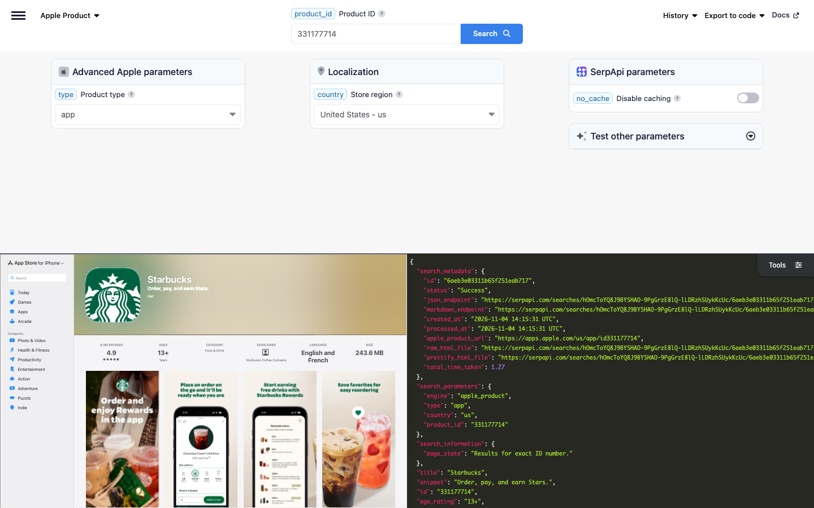

# Apple App Store Product Scraper

Scrape App Store product pages with SerpApi's Apple App Store Product API. Get an app's title, developer, rating, rating distribution, price, screenshots, description, version history, privacy details, size, compatibility, and similar apps.

## How to scrape Apple App Store product pages

Get the product page of an app with a simple GET request:

```text
https://serpapi.com/search?engine=apple_product&product_id=331177714&api_key=SERPAPI_API_KEY
```

- `product_id` is the App Store ID of the app, e.g., `331177714` for Starbucks. It's the number after `id` in the app's link, `https://apps.apple.com/us/app/starbucks/id331177714`, or the `id` of the app in the [Apple App Store API](https://serpapi.com/apple-app-store?utm_source=github_apple_app_store_product_scraper) results.
- `api_key` is your SerpApi API key. Replace `SERPAPI_API_KEY` with it.
- `country` sets the App Store region, e.g., `us` or `fr`.

[Register at SerpApi](https://serpapi.com?utm_source=github_apple_app_store_product_scraper) to get your API key, and keep it private.

### Playground

Try the request live in the [SerpApi Playground](https://serpapi.com/playground?engine=apple_product&product_id=331177714&utm_source=github_apple_app_store_product_scraper).

[](https://serpapi.com/playground?engine=apple_product&product_id=331177714&utm_source=github_apple_app_store_product_scraper)

## Code examples

The code examples read your API key from the `SERPAPI_API_KEY` environment variable:

```bash
export SERPAPI_API_KEY="SERPAPI_API_KEY"
```

Each example gets the product page of the Starbucks app and prints its title, rating, and number of ratings, followed by the release date of each recent version.

### curl integration

Send the request with curl, which prints the full JSON response:

```bash
curl --get https://serpapi.com/search \
 --data-urlencode engine="apple_product" \
 --data-urlencode product_id="331177714" \
 --data-urlencode api_key="$SERPAPI_API_KEY"
```

### JavaScript integration

Install the [SerpApi JavaScript library](https://github.com/serpapi/serpapi-javascript) and set your project to use ES modules:

```bash
npm install serpapi
npm pkg set type=module
```

Create an `index.js` file:

```javascript
import { getJson } from "serpapi";

const results = await getJson({
  engine: "apple_product",
  api_key: process.env.SERPAPI_API_KEY,
  product_id: "331177714",
});

console.log(results.title, results.rating, results.rating_count);
for (const version of results.version_history ?? []) {
  console.log(version.release_version, version.release_date);
}
```

Run it with `node index.js`.

### Python integration

Install the [SerpApi Python library](https://github.com/serpapi/serpapi-python):

```bash
pip install serpapi
```

Create a `main.py` file:

```python
import os
import serpapi

client = serpapi.Client(api_key=os.getenv("SERPAPI_API_KEY"))
results = client.search({
    "engine": "apple_product",
    "product_id": "331177714",
})

print(results["title"], results["rating"], results["rating_count"])
for version in results.get("version_history", []):
    print(version["release_version"], version["release_date"])
```

Run it with `python main.py`.

### Ruby integration

Install the [SerpApi Ruby library](https://github.com/serpapi/serpapi-ruby):

```bash
gem install serpapi
```

Create a `main.rb` file:

```ruby
require "serpapi"

client = SerpApi::Client.new(engine: "apple_product", api_key: ENV.fetch("SERPAPI_API_KEY"))
results = client.search(product_id: "331177714")

puts "#{results[:title]} #{results[:rating]} #{results[:rating_count]}"
results.fetch(:version_history, []).each do |version|
  puts "#{version[:release_version]} #{version[:release_date]}"
end

client.close
```

Run it with `ruby main.rb`.

### PHP integration

Install the [SerpApi PHP library](https://github.com/serpapi/serpapi-php):

```bash
composer require serpapi/serpapi-php
```

Create an `index.php` file:

```php
<?php
require 'vendor/autoload.php';

use SerpApi\Client;

$client = new Client(getenv('SERPAPI_API_KEY'), 'apple_product');
$results = $client->search([
  'product_id' => '331177714',
]);

echo $results->title . ' ' . $results->rating . ' ' . $results->rating_count . PHP_EOL;
foreach ($results->version_history ?? [] as $version) {
  echo $version->release_version . ' ' . $version->release_date . PHP_EOL;
}
```

Run it with `php index.php`.

### Go integration

Create a Go module and install the [SerpApi Go library](https://github.com/serpapi/serpapi-golang):

```bash
go mod init example.com/product
go get github.com/serpapi/serpapi-golang
```

Create a `main.go` file:

```go
package main

import (
	"fmt"
	"os"

	"github.com/serpapi/serpapi-golang"
)

func main() {
	setting := serpapi.NewSerpApiClientSetting(os.Getenv("SERPAPI_API_KEY"))
	setting.Engine = "apple_product"
	client := serpapi.NewClient(setting)

	results, err := client.Search(map[string]string{
		"product_id": "331177714",
	})
	if err != nil {
		panic(err)
	}

	fmt.Println(results["title"], results["rating"], results["rating_count"])
	versions, _ := results["version_history"].([]interface{})
	for _, item := range versions {
		version := item.(map[string]interface{})
		fmt.Println(version["release_version"], version["release_date"])
	}
}
```

Run it with `go run .`.

### Rust integration

Create a Cargo project and add the [SerpApi Rust library](https://github.com/serpapi/serpapi-rust) and Tokio:

```bash
cargo new product && cd product
cargo add serpapi tokio --features tokio/full
```

Replace `src/main.rs` with:

```rust
use serpapi::serpapi::Client;
use std::collections::HashMap;
use std::env;

#[tokio::main]
async fn main() -> Result<(), Box<dyn std::error::Error>> {
    let mut default = HashMap::new();
    default.insert("api_key".to_string(), env::var("SERPAPI_API_KEY")?);
    default.insert("engine".to_string(), "apple_product".to_string());
    let client = Client::new(default)?;

    let mut parameter = HashMap::new();
    parameter.insert("product_id".to_string(), "331177714".to_string());

    let results = client.search(parameter).await?;
    println!(
        "{} {} {}",
        results["title"].as_str().unwrap_or_default(),
        results["rating"],
        results["rating_count"].as_str().unwrap_or_default()
    );
    if let Some(versions) = results["version_history"].as_array() {
        for version in versions {
            println!(
                "{} {}",
                version["release_version"].as_str().unwrap_or_default(),
                version["release_date"].as_str().unwrap_or_default()
            );
        }
    }
    Ok(())
}
```

Run it with `cargo run`.

### Other programming languages

Official libraries are also available for [Java](https://github.com/serpapi/serpapi-java), [.NET](https://github.com/serpapi/serpapi-dotnet), [Swift](https://github.com/serpapi/serpapi-swift), and [C++](https://github.com/serpapi/serpapi-cpp). See [SerpApi integrations](https://serpapi.com/integrations?utm_source=github_apple_app_store_product_scraper) for setup guides, or use a simple GET request from any programming language.

### Errors

Failed requests return an HTTP error status and a JSON body with an `error` message. The most common are `401` for an invalid API key, `400` for a missing required parameter such as `product_id`, and `429` when you exceed your hourly throughput limit or run out of searches. See [API status and error codes](https://serpapi.com/api-status-and-error-codes?utm_source=github_apple_app_store_product_scraper) for the full list.

## Output formats: JSON and Markdown

Choose structured JSON for applications or Markdown for LLMs and AI agents:

- JSON is the default output and is useful when you need individual result fields.
- Add `output=md` to receive Markdown instead, which is more token-efficient.

Markdown is plain text, not JSON: YAML front matter with the search metadata, followed by the details of the app. Read the response body as text instead of parsing it.

| Client | Markdown request |
|--------|------------------|
| curl | `--data-urlencode output="md"` |
| Python | `client.search({..., "output": "md"})` |
| PHP | `$client->md([...])` |
| Rust | `client.md(parameter).await?` |

If your SDK doesn't have a Markdown helper yet, send a plain HTTP request with `output=md` and read the body as text. Learn more about [Markdown output](https://serpapi.com/markdown-output?utm_source=github_apple_app_store_product_scraper).

## Apple App Store Product API parameters

See the [Apple App Store Product API documentation](https://serpapi.com/apple-product?utm_source=github_apple_app_store_product_scraper) for more details.

| Name | Description | Requirement |
|------|-------------|-------------|
| **Search query** | | |
| `product_id` | The App Store ID of the app (e.g., `331177714`). It's the number after `id` in the link of the app, or the `id` of the app in the Apple App Store API results. | Required |
| **Advanced parameters** | | |
| `type` | The type of product. Only `app` (default) is supported. | Optional |
| **Localization** | | |
| `country` | The App Store region, as a two-letter country code (e.g., `us`, `uk`, `fr`). Defaults to `us`. See [Apple regions](https://serpapi.com/apple-regions?utm_source=github_apple_app_store_product_scraper) for supported regions. | Optional |
| **SerpApi parameters** | | |
| `engine` | Set to `apple_product`. | Required |
| `api_key` | Your private SerpApi API key. | Required |
| `no_cache` | Set to `true` to request fresh results instead of using the one-hour cache. Can't be combined with `async`. | Optional |
| `async` | Set to `true` for later retrieval through the [Searches Archive API](https://serpapi.com/search-archive-api?utm_source=github_apple_app_store_product_scraper). Can't be combined with `no_cache` or used with Ludicrous Speed enabled. | Optional |
| `zero_trace` | Enterprise only. Set to `true` to skip storing search parameters, files, and metadata on SerpApi servers. | Optional |
| `output` | Set to `json` (default), `html` for the raw HTML retrieved, or `md` for Markdown. | Optional |
| `json_restrictor` | Limit the JSON response to the fields you need. See the [JSON Restrictor](https://serpapi.com/json-restrictor?utm_source=github_apple_app_store_product_scraper) documentation. | Optional |

## Available data on Apple App Store product pages (JSON response)

The response describes one app, with its fields at the top level. The field guides below describe the possible fields and their types; they aren't literal API responses.

### What you get depends on the app

Some fields appear only when the product page shows them:

| App | Fields |
|-----|--------|
| A paid app | `price` with the price, e.g., $3.99, instead of Get |
| An app with in-app purchases | `in_app_purchases` |
| An iPad app | `designed_for`, e.g., Designed for iPad, and `ipad_screenshots` |
| An app for Apple Watch or iMessage | `watch_screenshots` or `messages_screenshots` |
| An app featured in App Store stories | `featured_in` |
| A review with a reply from the developer | `ratings_and_reviews.review_examples[].response_text` |

To get all the reviews of the app, use the [Apple App Store Reviews API](https://serpapi.com/apple-reviews?utm_source=github_apple_app_store_product_scraper).

### App details

The top-level fields describe the app:

```json
{
  "title": "String - Name of the app",
  "snippet": "String - Subtitle of the app, e.g., Order, pay, and earn Stars.",
  "id": "String - App Store ID of the app",
  "age_rating": "String - Age rating, e.g., 13+",
  "designed_for": "String - Device the app is designed for, e.g., Designed for iPad",
  "developer": {
    "name": "String - Name of the developer",
    "link": "String - Link to the developer's page on the App Store"
  },
  "rating": "Float - Average rating, e.g., 4.9",
  "rating_count": "String - Number of ratings, as displayed, e.g., 8.5M Ratings",
  "price": "String - Price, as displayed, e.g., Get or $3.99",
  "in_app_purchases": "String - Shown when the app offers in-app purchases, e.g., In-App Purchases",
  "logo": "String - Link to the icon of the app",
  "iphone_screenshots": "Array[String] - Links to the iPhone screenshots",
  "ipad_screenshots": "Array[String] - Links to the iPad screenshots",
  "watch_screenshots": "Array[String] - Links to the Apple Watch screenshots",
  "messages_screenshots": "Array[String] - Links to the iMessage screenshots",
  "description": "String - Description of the app",
  "version_history": [
    {
      "release_version": "String - Version number, e.g., 6.134.1",
      "release_notes": "String - Release notes of the version",
      "release_date": "String - Release date of the version, e.g., 2026-11-02"
    }
  ],
  "featured_in": [
    {
      "image": "String - Link to the image of the story",
      "title": "String - Label of the story, e.g., GET STARTED",
      "link": "String - Link to the story on the App Store",
      "description_title": "String - Title of the story",
      "description": "String - Description of the story"
    }
  ]
}
```

### Ratings and reviews

`ratings_and_reviews` has the number of ratings per star and the reviews shown on the product page:

```json
{
  "ratings_and_reviews": {
    "rating_distribution": {
      "5_star": "Integer - Number of 5-star ratings",
      "4_star": "Integer - Number of 4-star ratings",
      "3_star": "Integer - Number of 3-star ratings",
      "2_star": "Integer - Number of 2-star ratings",
      "1_star": "Integer - Number of 1-star ratings"
    },
    "review_examples": [
      {
        "rating": "String - Rating from 1 to 5",
        "username": "String - Username of the reviewer",
        "review_date": "String - Date of the review, e.g., 11/12/2021",
        "review_title": "String - Title of the review",
        "review_text": "String - Text of the review",
        "response_text": "String - Reply from the developer"
      }
    ]
  }
}
```

### Privacy and information

`privacy` summarizes the app's privacy label, `information` has the details from the Information section, and `supports` lists the Apple features the app supports:

```json
{
  "privacy": {
    "description": "String - Summary of the privacy practices, with HTML formatting",
    "privacy_policy_link": "String - Link to the developer's privacy policy",
    "cards": [
      {
        "title": "String - Type of data use, e.g., Data Used to Track You",
        "description": "String - Description of the data use",
        "categories": "Array[String] - Categories of data, e.g., Identifiers, Purchases"
      }
    ],
    "sidenote": "String - Note about the privacy practices",
    "learn_more_link": "String - Link to Apple's explanation of privacy labels"
  },
  "information": {
    "seller": "String - Seller of the app",
    "size": "String - Size of the app, e.g., 243.6 MB",
    "category": "String - Category of the app, e.g., Food & Drink",
    "compatibility": "String - Device requirements, e.g., Requires iOS 17.5 or later.",
    "location": "String - How the app uses your location",
    "languages": "String - Supported languages, e.g., English and French",
    "age_rating": "String - Age rating, e.g., 13+",
    "copyright": "String - Copyright of the app"
  },
  "supports": [
    {
      "title": "String - Apple feature, e.g., Wallet",
      "description": "String - Description of the feature"
    }
  ]
}
```

### Similar apps

`you_may_also_like` and `more_by_this_developer` list other apps, each with a `serpapi_link` to its product page:

```json
{
  "you_may_also_like": {
    "apps": [
      {
        "logo": "String - Link to the icon of the app",
        "link": "String - Link to the app on the App Store",
        "name": "String - Name of the app",
        "category": "String - Category or subtitle of the app",
        "id": "Integer - App Store ID of the app",
        "serpapi_link": "String - SerpApi link to the product page of the app"
      }
    ],
    "result_type": "String - Whether the list has all the apps, e.g., Partial",
    "see_all_link": "String - Link to all the apps on the App Store"
  },
  "more_by_this_developer": {
    "apps": "Array[Object] - Other apps by the developer, with the same fields as you_may_also_like.apps",
    "result_type": "String - Whether the list has all the apps, e.g., Partial",
    "see_all_link": "String - Link to the developer's page on the App Store"
  }
}
```

## AI agents and no-code

### MCP

Give AI agents and assistants an App Store product page tool with the hosted [SerpApi MCP server](https://github.com/serpapi/serpapi-mcp) at `https://mcp.serpapi.com/mcp`.

Claude Code:

```bash
claude mcp add --transport http serpapi https://mcp.serpapi.com/mcp --header "Authorization: Bearer $SERPAPI_API_KEY"
```

Codex, which reads the key from `SERPAPI_API_KEY`:

```bash
codex mcp add serpapi --url https://mcp.serpapi.com/mcp --bearer-token-env-var SERPAPI_API_KEY
```

Other MCP clients:

```json
{
  "mcpServers": {
    "serpapi": {
      "type": "http",
      "url": "https://mcp.serpapi.com/SERPAPI_API_KEY/mcp"
    }
  }
}
```

The server's engine catalog includes the `apple_product` engine, and its `serpapi://engines/apple_product` resource describes the parameters. Ask your agent to get the product page of an app with the `apple_product` engine. The resulting tool call looks like this:

```json
{
  "name": "search",
  "arguments": {
    "params": {
      "engine": "apple_product",
      "product_id": "331177714"
    }
  }
}
```

See the [MCP integration guide](https://serpapi.com/integrations/mcp?utm_source=github_apple_app_store_product_scraper) for more clients and self-hosting.

### CLI

Get App Store product pages from your terminal or from AI agent workflows with the [SerpApi CLI](https://github.com/serpapi/serpapi-cli):

```bash
brew tap serpapi/homebrew-tap
brew install serpapi-cli
```

The CLI picks up `SERPAPI_API_KEY` from your environment. You can also run `serpapi login` to save a key.

```bash
serpapi search engine=apple_product product_id=331177714
serpapi search engine=apple_product product_id=331177714 --fields "title,rating,rating_count,version_history[0]"
serpapi search engine=apple_product product_id=331177714 output=md
```

### No-code tools

Use SerpApi APIs without writing code:

- [NoCodeSerpApi](https://nocodeserpapi.com/)
- [SerpApi with n8n](https://serpapi.com/blog/tag/n8n/)
- [SerpApi with Make](https://serpapi.com/blog/tag/make/)
- [More integrations](https://github.com/serpapi/serpapi-integrations/)

## Use cases

- Track the ratings, rating distribution, and price of your app and competing apps.
- Follow how often competitors release updates, and what their release notes say.
- Compare the privacy labels of apps in a category.
- Build app detail pages with icons, screenshots, descriptions, and compatibility.
- Discover similar apps and other apps by the same developer.
- Give AI agents and RAG pipelines detailed app information.

## Related scrapers

- [Apple App Store Scraper](https://github.com/serpapi/apple-app-store-scraper): search apps and find their IDs
- [Apple App Store Reviews Scraper](https://github.com/serpapi/apple-app-store-reviews-scraper): reviews of an app
- [Google Play Product Scraper](https://github.com/serpapi/google-play-app-scraper): product pages of Android apps on Google Play

## Resources

- [Scraping Apple App Store Product Info And Reviews with Python](https://serpapi.com/blog/scraping-apple-app-store-product-info-and-reviews-with-python/)
- [Web scraping Apple App Store Product Info And Reviews with Nodejs](https://serpapi.com/blog/web-scraping-apple-app-store-product-info-and-reviews-with-nodejs/)
- [Product Page Optimization for Mobile Apps: Utilizing Apple App Store Product Page Scraper API for Polynomial Regression](https://serpapi.com/blog/product-page-optimization-for-mobile-apps-utilizing-apple-app-store-product-page-scraper-api-for-polynomial-regression/)

## Contact

Feel free to reach out at [contact@serpapi.com](mailto:contact@serpapi.com).
